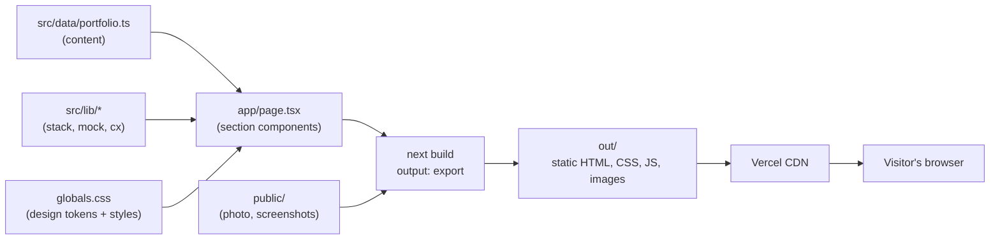
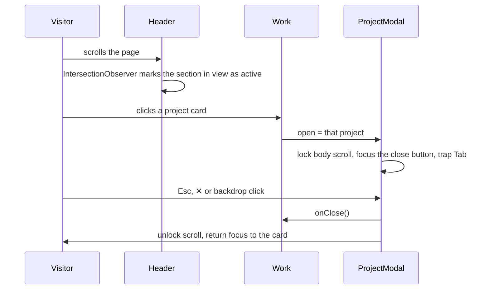

# Portfolio site

A one-page developer portfolio: a hero, an about section with skills, a project gallery with detail modals, a career timeline and a contact panel. It's built as a fully static site with Next.js and deployed to Vercel.

- **Live structure:** Home → About → Work → Journey → Contact, with a fixed header
- **Design style:** "Sketchbook": warm paper tones, ink outlines, offset shadows and handwritten notes
- **Content model:** every word, project, date and link lives in one typed data file

---

## Contents

1. [Tech stack](#tech-stack)
2. [Architecture](#architecture)
3. [Project structure](#project-structure)
4. [Solution design](#solution-design)
5. [Design system](#design-system)
6. [Accessibility, performance and SEO](#accessibility-performance-and-seo)
7. [Code quality](#code-quality)
8. [Getting started](#getting-started)
9. [Editing the content](#editing-the-content)
10. [Deployment](#deployment)
11. [Design decisions and trade-offs](#design-decisions-and-trade-offs)

---

## Tech stack

| Layer      | Technology                                                | Version | Why it was chosen                                                                                                |
| ---------- | --------------------------------------------------------- | ------- | ---------------------------------------------------------------------------------------------------------------- |
| Framework  | [Next.js](https://nextjs.org) (App Router, static export) | 16.4    | Pre-renders the page to plain HTML at build time: fast first paint, readable by search engines, no server to run |
| UI library | React                                                     | 19.3    | Component model for the sections, cards and modal                                                                |
| Language   | TypeScript (strict)                                       | 5.9     | Typed content model catches data mistakes at build time                                                          |
| Styling    | Tailwind CSS v4 + hand-written component CSS              | 4.3     | Tailwind supplies the reset and token utilities; the signature "sketch" styles are plain CSS in one file         |
| Animation  | [Motion](https://motion.dev) (formerly Framer Motion)     | 14.3    | Enter and exit animations for the project modal                                                                  |
| Icons      | [Lucide React](https://lucide.dev)                        | 1.57    | Consistent outline icons, imported one by one so only the used icons ship                                        |
| Fonts      | `next/font/google`: Plus Jakarta Sans and Caveat          | —       | Self-hosted at build time: no layout shift and no request to Google at runtime                                   |
| Linting    | ESLint 9 (flat config) with `eslint-config-next`          | 9.39    | React, hooks, Next.js and accessibility rules, plus extra readability rules                                      |
| Formatting | Prettier + `prettier-plugin-tailwindcss`                  | 3.9     | One consistent code style; `eslint-config-prettier` stops the two tools from clashing                            |
| Hosting    | Vercel                                                    | —       | Free tier, a preview URL for every push, custom domain with HTTPS                                                |

**No backend.** The site is static content. Contact goes through `mailto:` and LinkedIn, so there is no server, database or API to maintain or secure.

---

## Architecture

### Build-time rendering



`next build` runs every component once, at build time, and writes the finished HTML to `out/`. Vercel serves those files from its CDN. Nothing runs on a server per visit.

### Server and client components

Most of the page is plain server-rendered HTML. JavaScript is only sent for the parts that need to react to the visitor:

| Component                                   | Type   | Why                                                                  |
| ------------------------------------------- | ------ | -------------------------------------------------------------------- |
| `Hero`, `About`, `Journey`, `Contact`       | Server | Static content, no interactivity                                     |
| `Header`                                    | Client | Scroll state, active-section highlight, mobile menu                  |
| `Work` (with `ProjectCard`, `ProjectModal`) | Client | Holds the "which project is open" state                              |
| `RevealOnScroll`                            | Client | Adds the fade-in class as sections scroll into view; renders nothing |

### Runtime behavior



---

## Project structure

```
portfolio/
├── public/
│   ├── noel.jpg                 # hero photo (cropped square)
│   └── projects/*.jpg           # optimized project screenshots (max 1400px, JPEG ~82%)
├── src/
│   ├── app/
│   │   ├── layout.tsx           # <html>, fonts, metadata (title, description, Open Graph)
│   │   ├── page.tsx             # assembles the sections in page order
│   │   └── globals.css          # design tokens, Tailwind theme, all component styles
│   ├── components/
│   │   ├── Header.tsx           # fixed header, active link, mobile menu
│   │   ├── Hero.tsx             # greeting, headline, CTAs, framed photo
│   │   ├── About.tsx            # bio, AI workflow strip, skill cards
│   │   ├── Journey.tsx          # alternating career timeline
│   │   ├── Contact.tsx          # contact panel and footer
│   │   ├── RevealOnScroll.tsx   # scroll-triggered fade-in
│   │   └── work/
│   │       ├── Work.tsx         # section, featured grid, "more" row, modal state
│   │       ├── ProjectCard.tsx  # one card (full or compact)
│   │       ├── ProjectModal.tsx # detail dialog
│   │       ├── ProjectArt.tsx   # screenshot or NDA-safe illustration
│   │       └── Tags.tsx         # colored tech tags and the "+N" spread
│   ├── data/
│   │   └── portfolio.ts         # ALL content: profile, skills, projects, jobs, contact
│   └── lib/
│       ├── stack.ts             # tech → layer map, accent colors, tag picking
│       ├── mock.ts              # SVG illustrations for projects without screenshots
│       └── cx.ts                # class-name join helper
├── eslint.config.mjs            # ESLint flat config (Next.js + readability rules + Prettier)
├── .prettierrc.json             # Prettier settings
├── next.config.ts               # output: "export", unoptimized images
└── .vscode/                     # format on save, recommended extensions
```

**Rule of thumb:** `data/` is _what_ the site says, `components/` is _how_ it's laid out, `lib/` is shared logic, and `globals.css` is _how it looks_.

---

## Solution design

### 1. Content is data, components only render it

Every piece of content lives in `src/data/portfolio.ts` as typed objects (`Project`, `Job`, `SkillGroup`, plus `profile`, `about`, `contact`). Components import the data and map over it. They contain no hard-coded copy.

- Updating the portfolio means editing one file. No markup changes are needed.
- TypeScript enforces the shape. A project with a missing `role`, a misspelled accent color or a wrong illustration type fails the build instead of shipping broken.
- The same site can be reused for another person by swapping the data file, the photo and the screenshots.

### 2. Featured order is configuration, not code

`FEATURED` is a list of project titles. The first six render as large cards in that exact order; every other project automatically goes to the compact "and a few more" row. Re-ordering the gallery is a one-line change.

### 3. Full-stack tags, colored by layer

`lib/stack.ts` maps every technology to a layer: front end, back end, database, testing, or cloud and DevOps. The UI uses that map to:

- **Color each tag** by its layer, with a legend above the gallery.
- **Pick card tags round-robin across layers** (`pickTags`). A card shows up to 8 tags (4 on compact cards) drawn evenly from each layer, so a full-stack project doesn't look front-end only. The remainder collapses into a "+N" chip.
- **Group the full stack by layer** in the modal, one labelled row per layer.

### 4. Screenshots when allowed, illustrations when under NDA

`ProjectArt` decides what to show:

- **Project has `img`:** the real screenshot. On cards it's cropped with a per-project `object-position`; in the modal it's shown whole, centered, as a full-width banner.
- **No `img`:** an SVG "mock screen" from `lib/mock.ts`, drawn in the project's accent color (dashboard, checkout, routing grid, phone, chart, CMS and so on). It hints at the product without showing any client UI, and the modal adds an "illustration only" note.

### 5. Accessible modal without a library

`ProjectModal` is a hand-built dialog: `role="dialog"`, `aria-modal`, a labelled title, focus moved to the close button on open, Tab trapped inside, Esc / ✕ / backdrop to close, body scroll locked, and focus returned to the card that opened it. Motion's `AnimatePresence` handles the enter and exit animation and respects reduced-motion settings.

### 6. Scroll reveal that never hides content

Sections fade up as they scroll into view. To make sure content is never lost:

- A one-line inline script adds a `js` class to `<html>` before first paint.
- The hidden starting state only applies under `.js .reveal`, so with JavaScript disabled everything is simply visible.
- `prefers-reduced-motion` turns the animation off.

### 7. Static export

`next.config.ts` sets `output: "export"`, so the build is plain files with no Node.js server. Because of that, `next/image` optimization is turned off (`images.unoptimized`). Screenshots are optimized once, ahead of time, instead.

---

## Design system

All tokens are CSS custom properties at the top of `src/app/globals.css`, and are also exposed to Tailwind through `@theme` (`bg-paper`, `text-ink`, `border-primary`, `font-hand` …).

| Token group | Values                                                                         |
| ----------- | ------------------------------------------------------------------------------ |
| Brand       | `--primary #087EA4`, plus `--primary-dark`, `--primary-tint`, `--primary-wash` |
| Paper       | `--paper #FBF8F3` (light sections), `--paper-2 #F4EFE6` (alternate sections)   |
| Ink         | `--ink #1E2A32`, `--ink-2`, `--ink-3` for headings, body and muted text        |
| Accents     | amber, coral, green, purple, slate (timeline, skills, illustrations)           |
| Type        | Plus Jakarta Sans (400–800) for everything; Caveat for handwritten touches     |

Signature details: `1.5px` ink outlines, hard offset shadows on hover (`6px 6px 0 var(--ink)`), a wavy amber underline in the headline, a blob-shaped photo frame, and sections that alternate between the two paper tones.

**Why plain CSS for components:** the look relies on many one-off details (offset shadows, blob radii, the timeline connector lines). Keeping them as named classes in one stylesheet made them easier to tune visually than long utility strings. Tailwind is still used for its reset, the theme tokens, and utilities in new code.

---

## Accessibility, performance and SEO

**Accessibility**

- Semantic landmarks (`header`, `nav`, `main`, `section`, `footer`) and an ordered list for the timeline.
- Every project card is a real `<button>`; the modal is a proper dialog with focus management.
- The mobile menu button exposes `aria-expanded` and `aria-controls`; the current section link gets `aria-current`.
- Decorative elements (sparkles, notes, sticker, illustrations) are hidden from screen readers.
- Reduced-motion preferences are respected for scrolling, reveals and the modal.

**Performance**

- The whole page is pre-rendered HTML; only the header, gallery and reveal logic hydrate.
- Fonts are self-hosted by `next/font`, so there's no layout shift or third-party font request.
- Screenshots were resized and compressed ahead of time (about 1.2 MB for all seven), and load lazily.
- Icons are imported individually, so only the icons in use are bundled.

**SEO**

- Title, meta description and Open Graph tags come from `profile` in the data file.
- All text is in the initial HTML, so search engines and link previews see the full content.

---

## Code quality

| Command             | What it does                                                                                                                                                   |
| ------------------- | -------------------------------------------------------------------------------------------------------------------------------------------------------------- |
| `npm run typecheck` | TypeScript in strict mode                                                                                                                                      |
| `npm run lint`      | ESLint: Next.js, React hooks and accessibility rules, plus `eqeqeq`, `prefer-const`, `no-console`, type-only imports, self-closing tags and no unneeded braces |
| `npm run lint:fix`  | Fixes the ESLint issues that can be fixed automatically                                                                                                        |
| `npm run format`    | Reformats every file with Prettier (Tailwind classes are sorted too)                                                                                           |
| `npm run check`     | Type check, lint and format check together, without changing files                                                                                             |

In VS Code, install the recommended extensions when prompted (Prettier, ESLint, Tailwind CSS). Files then format and fix themselves on save.

**Conditional class names:** always use `cx("card", open && "open")` from `src/lib/cx.ts`. Don't write `` `card${open ? " open" : ""}` ``: the Tailwind Prettier plugin trims the leading space and glues the class names together.

---

## Getting started

Requires Node.js 20 or later.

```bash
npm install
npm run dev
```

Open http://localhost:3000.

```bash
npm run check   # type check, lint, format check
npm run build   # writes the static site to out/
```

---

## Editing the content

Almost everything lives in **`src/data/portfolio.ts`**:

| What                                                              | Where in `portfolio.ts` |
| ----------------------------------------------------------------- | ----------------------- |
| Name, headline, subtitle, photo, email, LinkedIn, SEO description | `profile`               |
| About text, AI workflow steps                                     | `about`                 |
| Skill cards                                                       | `skills`                |
| Projects (card text, modal text, tags, screenshot)                | `projects`              |
| Which 6 projects are featured, and their order                    | `FEATURED`              |
| Timeline entries                                                  | `jobs`                  |
| Contact panel text                                                | `contact`               |

- **Images:** put files in `public/` and reference them from the site root, for example `/projects/name.jpg`. Resize screenshots to at most 1400px wide before adding them.
- **NDA work:** leave out `img` on the project, and its `mock` illustration is shown instead.
- **Current role:** set `current: true` on a project to show the amber "Current role" badge on its card and in its modal.
- **New technology:** add it to the right layer in `src/lib/stack.ts` so its tag gets the right color. Unknown tags default to front end.
- **Colors:** change `--primary` and its three tints at the top of `src/app/globals.css`.

---

## Deployment

1. Push this folder to a GitHub repository.
2. In Vercel, choose **Add New → Project**, import the repository, and keep the detected Next.js settings.
3. Every push to the main branch redeploys automatically; pull requests get preview URLs. Add a custom domain under **Settings → Domains**.

Because the build is plain static files in `out/`, the site can also be hosted on Netlify, Cloudflare Pages, GitHub Pages or any static file host.

---

## Design decisions and trade-offs

| Decision                           | Alternative considered                                       | Why                                                                                                                                     |
| ---------------------------------- | ------------------------------------------------------------ | --------------------------------------------------------------------------------------------------------------------------------------- |
| Static export, no backend          | Server-rendered Next.js with an API route for a contact form | Nothing on the page changes per visitor; static files are faster, free to host and have nothing to secure                               |
| `mailto:` + LinkedIn for contact   | A form posting to Formspree or a serverless function         | Zero moving parts; a form can be added later without changing the architecture                                                          |
| One typed data file                | A headless CMS (Contentful, Sanity)                          | One editor, infrequent updates; a CMS would add accounts, API keys and build hooks for little gain                                      |
| Component styles in one CSS file   | Utility classes only                                         | The hand-drawn look has many one-off details that are easier to tune by name; Tailwind is still available                               |
| Plain `` for screenshots      | `next/image`                                                 | Image optimization needs a server, which a static export doesn't have; images are optimized ahead of time instead                       |
| Hand-built modal                   | A dialog library (Radix, Headless UI)                        | One dialog with simple needs; a single small component covers focus trap, Esc, scroll lock and focus return without adding a dependency |
| SVG illustrations for NDA projects | Blurred screenshots or no image                              | Shows the kind of product without leaking any client UI, and matches the site's drawn style                                             |
| Project order in `FEATURED`        | Sorting by date or a `featured: true` flag                   | Order is an editorial choice; a list of titles makes the order explicit and easy to change                                              |
